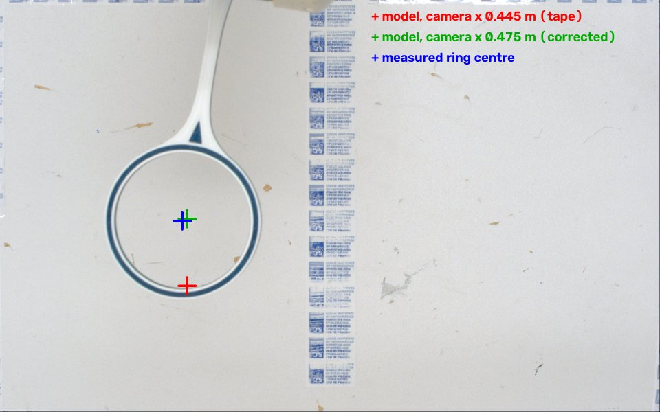

# CRS93 hoop task: simulation and solver

Prokop's part of the ROB1 semester project (CTU FEE): a simulation of the CRS93
station, so that the team can develop and test without booking the robot, and
Prokop's share of the team's solver (`solver/`, plan in
[docs/SOLVER_PLAN.md](docs/SOLVER_PLAN.md)). The task is variant D: the robot
moves a hoop along puzzle D standing on a spinning turntable, guided by the
camera above the table.

The core is `CRS93Sim`, a drop-in replacement for `ctu_crs.CRS93`. A script
written against the robot's interface runs in the sim and on the real robot by
changing one line. The sim behaves like the real station as measured there:
joint speeds, delays of the serial line, blending of queued moves, the hard
home pose, and the cell geometry around it.



## Quick start

From the repo root:

```bash
uv sync
uv run Prokop/demo_sim.py        # simulated robot homes, moves, traces a square
uv run Prokop/view_models.py     # interactive scene: joint sliders, turntable
uv run pytest Prokop/tests       # ~180 tests, a few minutes (on a small machine run
                                 #   the files one by one: the whole suite needs ~2 GiB)
```

Both programs serve the scene at http://localhost:8080.

```python
from simulation import CRS93Sim     # from ctu_crs import CRS93
robot = CRS93Sim()                  # robot = CRS93()
robot.initialize()                  # hard home, then q_home
robot.move_to_q(q)                  # returns after ~25 ms, like the real call
robot.wait_for_motion_stop()
```

The extra keyword arguments exist in the sim only:
- `q0`, `port`, `time_scale` (sim seconds per wall second), `keep_alive`;
- the hardware delays `command_delay`, `send_delay`, `query_delay`,
  `status_delay`, `camera_delay`. They default to the values measured on the
  CRS93; pass `0` for an ideal robot.

## How the simulation works

- **Same kinematics.** `CRS93Sim` subclasses `ctu_crs.CRS93`: `fk`, `ik`, joint
  limits, `q_home` and the unit conversions are the driver's own. Only the
  calls that talk to the MARS control unit are replaced.
- **Motion** (`simulation.Segment`).
  - Every `move_to_q` is a coordinated move: all joints follow one trapezoidal
    speed profile, with the real speed settings. Targets are rounded to encoder
    counts like the real commands.
  - Queued moves run one after another. A move continuing in exactly the same
    joint-space direction is blended into the previous one; any other starts
    from standstill. That's the real control unit's behaviour (E6).
  - The rule is about joint space: a move curved in Cartesian space (e.g. j1
    alone sweeps an arc) runs smoothly if it is straight in joint space. Via
    points on such a line add nothing; one move to the end is the same motion.
  - To chain moves, offset from the previous *target*, not from `get_q()`
    (which returns the configuration mid-move): `move_to_q(q + d1)`,
    `move_to_q(q + d1 + d2)`. The second command has to arrive before the first
    move starts braking.
- **Delays.** `move_to_q` blocks for the serial write, and the motion starts
  `command_delay` later. `get_q` and `in_motion` block for their round trips
  and return the state from its middle.
- **One clock.** The robot, the delays and the turntable spin all run on one
  sim clock, scaled by `time_scale`. The viewer draws the whole scene at one
  instant.
- **Scene** (`view_models.SceneViewer`). Built from:
  - the robot URDF (generated from RoboDK, kinematics checked against
    `ctu_crs`),
  - the hoop, base, puzzles and turntable (from the CAD files of the hardware
    repo),
  - the measured cell (`cell.py`).
- **Camera** (`camera.py`). `grab_image` returns a 1920 × 1200 BGR image
  rendered from the scene with the camera model (pose and intrinsics of
  `cell.py`), with the real timing: it blocks 0.19 s (0.8 s the first time) and
  shows the scene as it was 0.11 s before it returns. The base markers are the
  real ones (`DICT_4X4_50`, ids 1 and 2), and markers and hoop appear within
  2–3 px of where the camera model projects them. Flat colours, no stickers or
  noise: for the logic of perception, not for tuning detection. The last image
  is shown in the viewer's "Camera" panel; `robot.camera` can be changed to
  render with a camera that differs from perception's calibration.
  Rendering is off-screen OpenGL (`moderngl`, EGL, works headless on WSL).
- **Hard collisions** (`collision.SceneCollider`, exact meshes). A monitor
  checks the arm against itself, the cell, the table, and the turntable, base
  and puzzle (spin included) along the motion, a little ahead of the clock. On
  contact, like a real crash stop:
  - the robot stops at the last collision-free configuration, the turntable
    stops, the colliding bodies turn red;
  - the next robot call raises `simulation.CollisionError` (with `hits`,
    `q_stop`, `q_start`); the script can catch it and go on;
  - every motion command raises again until **Release** is pressed in the
    viewer's "Collision" panel; `get_q` and `grab_image` keep working;
  - Release puts the robot back where the colliding move started.

  Touching the puzzle with the hoop counts as a collision. The monitor steps by
  clearance, so nothing can pass through between two checks; queries wait
  until the time they report is checked (at `time_scale` > 1 fast moves can
  then take more sim time than on the robot). This is the environment's
  ground truth; trajectory planning uses its own simplified collision model.
- **Soft collisions for planning** (`solver/soft_collision.py`, details in
  [docs/SOFT_COLLISION.md](docs/SOFT_COLLISION.md)). The model planning code
  uses instead of the exact meshes: every body as a few boxes
  (`models/soft/*_soft.urdf`), the task posed from the perceived `TurntableModel`,
  dot-product tests only. `SoftScene(model).clearance(q, theta)` gives the
  least distance (a guaranteed lower bound, margins subtracted) in ~1.5 ms.
- **Clearance for tools.** `collision.ArmChecker` gives the clearance of the
  arm and hoop to the table and the cell, for a pose or along the joint-space
  path of a move (used to check poses before moving the real robot).
- **Scenarios.** `robot.viewer.set_placement(Placement(...))` puts the turntable
  and the base where a test needs them.
- **Not simulated yet:** the control unit's queue limit and the small overshoot
  at the end of a real move.

## Solver (`solver/`)

The team's pipeline for the task, planned in
[docs/SOLVER_PLAN.md](docs/SOLVER_PLAN.md): (1) the turntable with the base and
puzzle estimated as a one-joint robot from camera images, (2) a plan optimized
over the whole timed traversal (start phase, hoop roll, IK branch; Natka's
code in `Natka/`, which `solver/__init__.py` puts on the import path), (3) execution with the turntable's phase tracked
by a delay-aware Kalman filter. The three of us work on its tasks in parallel;
the parts exchange only the types of `solver/contracts.py`, which also holds
fakes so that every part can be developed alone. Every part uses only the
`CRS93` interface, so it runs on the sim and the robot alike.

Prokop's parts so far:

| Module | Task | What |
|---|---|---|
| `solver/contracts.py` | C0 | shared types (`BaseMeasurement`, `TurntableModel`, `PuzzlePath`, `RobotTiming`, `PhaseEstimate`, `PhaseTracker`, `Plan`), the reference turntable chain, fakes; under review by the team |
| `solver/turntable_chain.py` | P1.1 | the turntable, base, puzzle and checkpoints as a one-joint URDF robot (lab 2); FK of every frame |
| `solver/timing.py` | P3.2 | the robot's measured timing; `schedule()` gives the arrival times of queued moves, with blending |
| `solver/approach.py` | P2.7 | collision-free approach paths: straight task-space line (`plan_line`, IK from Natka's `plan_ik`) checked against the cell, the table, the spinning task's swept volume and self-collision |
| `solver/correction.py` | P3.4 | planned targets corrected for the turntable's actual phase (Natka's numerical IK, `plan_ik.ik_numerical`) |
| `solver/executor.py` | P3.3 | runs a `Plan`: approach, wait for the start phase, send each step just in time with its correction (solved as a fixed point by secant steps; each step's send time fixed ahead of its IK), abort safely |
| `solver/soft_collision.py` | — | soft collision model for planning: boxes from `models/soft/*_soft.urdf`, separating-axis distances (lower bounds), hierarchy; see [docs/SOFT_COLLISION.md](docs/SOFT_COLLISION.md) |
| `solver/wire.py` | — | puzzle D's wire (centreline measured on the CAD) and its checkpoints at a granularity tier |
| `solver/hoop_pose.py` | — | flange poses that put the ring centre on a checkpoint (side, tilt, roll); IK candidates |
| `solver/planner.py` | P2 | Prokop's planner: static puzzle (tiers / RRT between checkpoints), spinning puzzle planned **backwards in time** from end angles in parallel (`plan_spinning`, `plan_backward`), approach clear of the swept volume (`plan_approach`); see [docs/PLANNER_EXPERIMENTS.md](docs/PLANNER_EXPERIMENTS.md) |
| `solver/rrt.py` | — | joint-space RRT with time-aware edges, shortcutting (lab 6) |
| `sim_process.py` | — | the simulator as a standalone process: the solver gets only a `ctu_crs.CRS93`; scene setup and ground truth on the `SimProcess` handle |
| `run_solver.py` | I1 | the whole pipeline phase by phase in the sim: Vojtěch's perception, Prokop's planner (`--planner natka\|copy` for Natka's), the executor with Vojtěch's `CameraPhaseTracker` (`--tracker fitted` for the model alone); each phase checked against the sim's truth, execution diagnostics (`execution.pkl`, `experiments/execution_replay.py`); stops at the first failing phase. `uv run Prokop/run_solver.py [--seed 3 --direction -1 \| --axis X Y --offset X Y --yaw DEG] [--stop-after 2] [--hold]`; log + frames in `Prokop/runs/` |

In the sim with the puzzle spinning (both directions) and a perfect tracker, the
executor keeps the hoop target within 3 mm of its planned place on the puzzle,
with arrivals within 30 ms of the timing model (`tests/test_executor.py`).

```python
import sys; sys.path.insert(0, "Prokop")       # from the repo root
from solver.contracts import example_model, example_plan, ModelTracker
from solver.executor import Executor
from solver.timing import RobotTiming
```

## Documentation

| Document | Contents |
|---|---|
| [docs/MEASUREMENTS.md](docs/MEASUREMENTS.md) | every measured, estimated or assumed value: what, how, where in the code |
| [docs/EXPERIMENTS.md](docs/EXPERIMENTS.md) | the experiments at the station (E1–E9): why, what, results, what changed |
| [docs/ROBOT_CHECKS.md](docs/ROBOT_CHECKS.md) | safety rules, running the tools at the station, open checks |
| [docs/SOLVER_PLAN.md](docs/SOLVER_PLAN.md) | the team's solver: pipeline, contracts, decisions, lab methods, tasks, split and status |
| [docs/SOFT_COLLISION.md](docs/SOFT_COLLISION.md) | the soft collision model for planning: boxes, test, margins, validation |
| [docs/PLANNER_EXPERIMENTS.md](docs/PLANNER_EXPERIMENTS.md) | planning: every experiment, test and solved problem (static and spinning puzzle), open ideas, scripts |
| [NOTIFY.md](NOTIFY.md) | notes for the team about changes that affect their code |

The modules and tools have Google-style docstrings; `--help` on any tool prints
its usage.

## Layout

| Path | Contents |
|---|---|
| `simulation.py` | `CRS93Sim`, the simulated robot |
| `view_models.py` | `SceneViewer` (the Viser scene) and the interactive viewer |
| `cell.py` | the static cell: table, work area, cage, camera rail, camera (pose, intrinsics) |
| `camera.py` | the simulated camera: `Camera` model, `SceneRenderer` (off-screen rendering) |
| `collision.py` | `SceneCollider` (hard collisions of the whole scene), `ArmChecker` (clearance to the table and the cell) |
| `placement.py` | task models; random turntable / base placement with tip-over and clearance checks |
| `demo_sim.py`, `demo_camera.py` | smoke tests of the simulation and the simulated camera |
| `solver/` | Prokop's parts of the team's solver and the shared contracts (see above) |
| `models/` | URDFs and STL meshes: robot with adapter, hoop, base, puzzles A–E, turntable |
| `tools/robodk2urdf.py`, `step2stl.py`, `mesh_repair.py` | model generators (robot URDF from RoboDK, meshes from STEP) |
| `tools/fit_soft_boxes.py` | fits the soft collision boxes to the models, writes `models/soft/*_soft.urdf` |
| `experiments/validate_soft_collision.py` | checks the soft model against the exact meshes |
| `tools/log_motion.py`, `camera_survey.py` | measurements on the real robot (also run against the sim) |
| `tools/lab_check.py` | the station checks before a real attempt: dimensions, camera calibration, timing, turntable perception, field of view (`docs/LAB_CHECK_GUIDE.md`) |
| `tools/analyze_motion.py`, `analyze_survey.py` | analysis of the recorded experiments |
| `experiments/` | recorded data: `motion_logs/real/`, `camera_survey/<date-time>/` |
| `docs/` | the documents above, `img/` |
| `tests/` | pytest suite: models, cell, collision, placement, sim interface, viewer, camera, tools, solver |

## Conventions

- **Units:** SI (m, rad, s); degrees only in printouts and docs.
- **Frame:** the `ctu_crs` robot base frame. x forward (where the arm points
  in `q_home`), y left, z up; the table lies at z = +1 mm.
- **Joint values** are exactly the `q` of `robot.move_to_q()`; the URDF
  `flange` frame equals `robot.fk(q)`.
- **Hoop:** in `q_home` it points up (the adapter is turned 180° on this
  station).

## Interfaces with the rest of the team

- **Camera (Vojtěch):** outputs poses (and matrices if needed) and should accept
  an input image: `robot.grab_image()` gives the real camera image or, with
  `CRS93Sim`, the rendered one, in the same format. A rendered image is good for
  finding logic errors, not for tuning detection.
- **Path planning (Natka):** outputs flange poses and joint configurations that
  go straight into `move_to_q`, on the sim or the robot. Mind the blending rule:
  bending chains of via points run stop-and-go (E6); smooth motion means long
  segments that are straight in joint space.
- **Solver:** the split of the tasks and the interfaces between the three parts
  are in [docs/SOLVER_PLAN.md](docs/SOLVER_PLAN.md) (contracts: section 4).

## Owner

`Prokop/` is maintained by Prokop; the other team members' directories are
theirs. Changes that affect their code are announced in `NOTIFY.md`.
