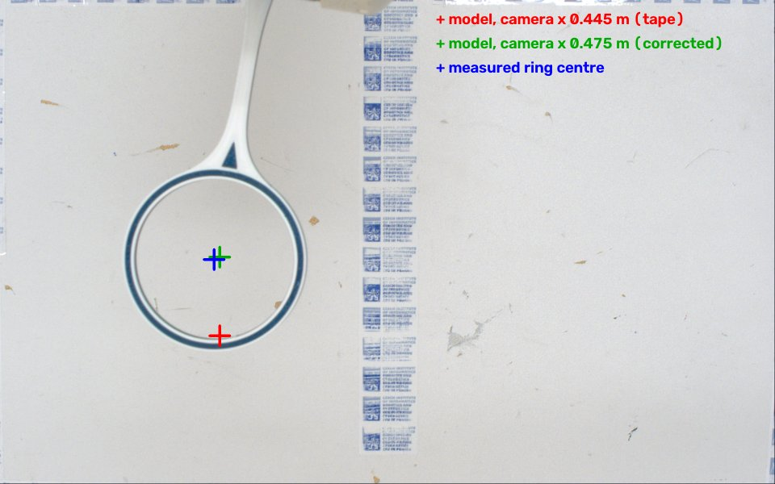

# Experiments

What we measured to make the simulation behave like the CRS93 station, in
order. For each experiment: why it was needed, what was done, where the data
is, what it showed, and what changed in the code. The resulting values are
collected in [MEASUREMENTS.md](MEASUREMENTS.md).

The numbers can be reproduced from the recorded data:

```bash
uv run Prokop/tools/analyze_motion.py --sim   # E5, E6: fits of the real logs, and the same tests in the sim
uv run Prokop/tools/analyze_survey.py         # E8: hoop in the survey image vs the camera model
```

| | Experiment | Date | Data |
|---|---|---|---|
| E1 | Table height and the robot's foot | 2026-10-20/21 | photo, tape |
| E2 | Cell geometry: work area, cage, rail, camera, turntable, base | 2026-10-20/21 | tape |
| E3 | Turntable period | 2026-10-21 | stopwatch |
| E4 | Homing and the hoop orientation | 2026-10-21 | `get_q`, observation |
| E5 | Motion profile and delays of the serial line | 2026-10-21 | `experiments/motion_logs/real/` (5 tests) |
| E6 | Blending of queued moves | 2026-10-21 | `experiments/motion_logs/real/` (4 tests) |
| E7 | Camera timing; first attempt at the image delay | 2026-10-21 | `experiments/camera_survey/20261021-1303*`, `-130400` |
| E8 | Image delay and camera position from a survey pose | 2026-10-21 | `experiments/camera_survey/20261021-134510/` |
| E9 | Focal length estimate | 2026-10-21 | analysis of E2 and E8 |

---

## E1: Table height and the robot's foot

**Why.** The table is the main obstacle for collision checking, and the
turntable stands on it. Its height in the robot frame was a guess.

**What.** A tape measure from the table to the top of the square steel foot
under the robot's round base, where the screws go in. Then we compared that
with the RoboDK base mesh by taking cross-sections at increasing height.

**Result.**
- **The foot is in the model.** The bottom 50.8 mm (2") of the base mesh is a
  203 mm square; above it starts the truncated cone of the round base.
- **The table is 25 mm below the foot's top.** So the table lies at z = +1.0 mm.
  That's almost exactly the `ctu_crs` base frame origin, a good sign that the
  numbers are consistent.
- **The foot sits in a cut-out.** The model's foot reaches 26 mm below the
  table surface, which the photo of the foot confirms.

**Mistake on the way.** The first reading took the round base for the bottom
of the model and put the table 31 mm below it (z = −55.8 mm). With the second,
the robot appeared to float 25 mm above the table. It was the cross-sections of
the mesh that showed the foot was in the model all along.

**Changed.** `cell.TABLE_Z`. The viewer's grid, the turntable placement and the
table check in `collision.py` all follow from it.

## E2: Cell geometry

**Why.** Collision checking needs the static obstacles (cage, camera rail,
camera). The simulated camera needs the camera's pose. Random placements need
the area where the turntable can stand.

**What.** Tape measurements at the CRS93 station:
- **Sticker rectangle** (the work area, just outside the camera view): 48.5 ×
  30 cm, 23.8 cm in front of the round base, centred.
- **Cage:** an octagon with 75 cm inner sides and a flat panel facing the
  robot's front, 40 mm frame, 108 cm high.
- **Camera rail:** a 40 × 40 mm profile along x, its top 131 cm above the
  table, on a post standing on the front cage wall.
- **Camera:** on the robot's axis, on the right side of the rail, 50 cm from
  the outer face of the front wall, pointing down; the lens is a 28 mm
  cylinder.
- **Turntable:** Ø 137 mm, 34 mm high.
- **Base:** 30 mm high with its foam (5 mm plate + 25 mm foam).

**Result.** The arm keeps clear of the cell: in `q_home`, with the hoop
pointing up (E4), the nearest obstacle is the camera rail, 26 cm away; with the
arm upright (q = 0) it is also the rail, 24 cm away. The camera x from the tape
turned out to be 3 cm off (E8).

**Changed.**
- New module `cell.py`: the cage, rail, post and camera as constants and
  collision meshes.
- New module `collision.py`: clearance of the arm and hoop to the cell and the
  table.
- `models/turntable.urdf`, and the foam in `models/base.urdf`.
- The viewer's "Cage + camera" part and the green work area.

## E3: Turntable period

**Why.** The task's puzzle spins with the turntable, so the sim needs its speed.
Path planning has to predict where the puzzle will be.

**What.** We timed full turns at the slowest speed with a stopwatch: 5
clockwise, 4 counter-clockwise.

**Result.**

| Direction | Mean | SD | Standard error |
|---|---|---|---|
| Clockwise (5) | 28.00 s | 0.12 s | ±0.05 s |
| Counter-clockwise (4) | 28.06 s | 0.04 s | ±0.02 s |
| All (9) | 28.03 s | 0.09 s | ±0.03 s |

The 0.06 s difference is about one standard error, so the speed is the same in
both directions: **28.0 s/rev**.

**Implication.** Over a 2-minute attempt (~4.3 turns), predicting the angle
from the period alone accumulates about 2–5° of error, which is ~1 cm at the
puzzle. The puzzle's angle has to be re-measured with the camera; the period
only bridges short gaps.

**Changed.** `view_models.SPIN_PERIOD` (was a guessed 16 s).

## E4: Homing and the hoop orientation

**Why.**
- **Hard home:** it drives the joints to their home switches without any
  collision checking, and the sim's version was a placeholder.
- **Hoop direction:** whether the model's hoop points the right way in
  `q_home`.

**What.** By hand on the robot computer: `initialize(home=False)`, then
`hard_home()` and `get_q()`, then `soft_home()` and `get_q()`. We watched the
arm and the hoop.

**Result.**
- **The hard home ends at (163.4, 0.3, −56.0, 176.7, 14.9, −172.0)°.** That's
  `ctu_crs`'s encoder zero (IRC 0) within 0.1°, as predicted: the control unit
  zeroes the encoders at the home switches.
- **The soft home reaches `q_home` = (0, 0, −45, 0, −45, 0)°.**
- **In `q_home` the hoop points up, and the model had it pointing down.** The
  adapter can be screwed on in 4 positions 90° apart, and on the CRS93 station
  it is turned by 180°. Vojtěch's old viewer compensated for this with a 180°
  offset on joint 6. That made the drawn flange disagree with `fk(q)`, so it
  had been removed earlier, which brought the error back.

**Changed.**
- `ADAPTER_TURN = π` in `tools/robodk2urdf.py`, written into
  `models/crs93.urdf`. `fk(q)` stays the real flange; the generator's
  `verify()` and `tests/test_models.py` check it.
- `CRS93Sim.hard_home` ends at the encoder-zero pose.

## E5: Motion profile and delays of the serial line

**Why.** For a script to behave the same in the sim as on the robot, the sim
needs the real joint speeds, the speed profile, and the delays of each call.
The instructors warned that hardware lag "will throw wrenches into our plans",
and the speed and acceleration units of `ctu_crs` were unverified.

**What.** `uv run Prokop/tools/log_motion.py --real` with the robot homed and
standing in `q_home`. Five short tests move only joints 1, 4 and 6, logging
`get_q` as fast as possible:

| Test | Question |
|---|---|
| `j1_30_speed025`, `j1_30_speed050` | joint speed and the speed-up / slow-down ramps |
| `j6_90_speed050` | the same for a wrist joint (different defaults) |
| `j1_queued_15_15` | two queued moves, 15° + 15°: does it stop in between? |
| `j1_30_j4_60_coord` | do two joints start and end together? |

`tools/analyze_motion.py` fits each move with a trapezoidal profile.

**Result.**

| | Real | Sim (assumed units) |
|---|---|---|
| j1 speed, setting 0.25 / 0.5 | 17.6 / 29.8°/s | 17.6 / 29.8°/s |
| j4 / j6 speed, setting 0.5 | 58.8 / 147.1°/s | 59.0 / 144.3°/s |
| Acceleration j1 / j4 / j6 | 170–390 / 276 / 3500°/s² | 140–180 / 283 / 3400°/s² |
| Motion start after `move_to_q` | 93–147 ms (mean 126) | 0 (no delays modelled yet) |
| `get_q` round trip | 51 ms (41–154) | 0 |
| Loop of `get_q` + `in_motion` | 61 ms → `in_motion` ~10 ms, ~18 Hz | — |

- **Speed units confirmed.** The speeds match to 0.1°/s.
- **Accelerations only roughly.** A ramp lasts 1–2 samples at 18 Hz, so the fit
  can't pin it down better than about ×2.
- **Coordinated moves.** The joints start and stop together.
- **End of a move.** The arm overshoots by ~0.3° and settles within ~0.25 s.
- **Queued moves blend in the same direction.** In `j1_queued_15_15` joint 1
  passes 15° at full speed (29.7°/s); the whole move takes as long as one 30°
  move. The sim stopped in between.

**Changed.**
- The measured delays became the `CRS93Sim` defaults: `command_delay` 0.12 s,
  `query_delay` 0.05 s, and a new `status_delay` 0.01 s for `in_motion`
  (`get_q` reads six joints, `in_motion` one status word).
- With these defaults a sim run gives `get_q` 51–54 ms, 16–17 Hz and a motion
  start of ~123 ms (fit).
- The blending question led to E6.

## E6: Blending of queued moves

**Why.** E5 showed that queued moves can blend. Path planning sends chains of
via points, so it matters exactly when the robot stops and when it doesn't.

**What.** `log_motion.py --real --tests j1_j4_corner j1_reverse j1_vias_10x3
j1_j4_arc_vias`:

| Test | Moves (queued without waiting) |
|---|---|
| `j1_j4_corner` | j1 to 20°, then j4 to 40° |
| `j1_reverse` | j1 to 20°, then back to 5° |
| `j1_vias_10x3` | j1 in ten steps of 3° |
| `j1_j4_arc_vias` | nine via points on a curve in j1 / j4 (like a planned path) |

**Result.**

| Test | Real | Sim (stop unless the same direction) |
|---|---|---|
| `j1_vias_10x3` | one smooth move, 1.12 s, ~29.7°/s throughout | one move, 1.01 s |
| `j1_queued_15_15` | one smooth move, 1.31 s | one move, 1.20 s |
| `j1_j4_corner` | j1 brakes to 0 at 20°, then j4 starts; 1.79 s | stops; 1.75 s |
| `j1_reverse` | stops at 20° (overshoots 0.3°), returns at once; 1.67 s | stops; 1.52 s |
| `j1_j4_arc_vias` | nearly stops at every via (down to a few °/s); 2.95 s | stops at every via; 3.00 s |

(The real legs are ~0.1–0.15 s longer because of the overshoot and settling,
which the sim leaves out.)

**Rule.** The control unit blends a queued move only if it continues in exactly
the same joint-space direction; otherwise the arm (nearly) stops first.

**Implication for path planning.** A path made of many slightly bending via
points runs stop-and-go. Smooth motion needs few, long segments, or straight
runs in joint space.

**Changed.** `CRS93Sim._enqueue` merges a queued move into the previous one if
the directions agree within `BLEND_TOL` and the previous one isn't slowing down
yet when the command arrives; otherwise the move starts from standstill. Also
new: `send_delay` 0.025 s, because ten queued calls took ~0.25 s before the
first `get_q`. Tests in `tests/test_simulation.py`.

## E7: Camera timing; first attempt at the image delay

**Why.** The camera loop (detect the puzzle, plan, move) is limited by how fast
images come and how old they are. Both are needed for the simulated camera.

**What.**
- `uv run Prokop/tools/camera_survey.py`: 30 grabs, timed.
- `camera_survey.py --delay` (first version): joint 1 swung +10° and back from
  `q_home`, grabbing frames and reading `get_q` alternately. The delay is the
  time shift at which the image change, plotted against the joint angle, is the
  same on the way out and back.

**Result.**
- **Resolution** 1920 × 1200 × 3.
- **`grab_image` takes 186 ms, the first call 0.8 s.** `ctu_crs` starts and
  stops the camera on every call, so each image is taken during the call and
  at most ~5 images/s are possible.
- **The delay test failed** (`mismatch: Infinity`), for two reasons:
  1. One sample (grab + `get_q`) took ~0.26 s, so each leg of the swing got
     only 2–3 frames; the estimator needs more than 3 per leg.
  2. In `q_home` the arm is hardly in view: at the flange's height (0.84 m)
     the camera only sees x 0.38–0.51 m, and the flange is at x 0.31 m. The
     image changed by 2.9 → 3.7 of 255, mostly noise.

**Changed.** The test was redesigned (E8), and a collision checker was written
for it (`collision.py`).

## E8: Image delay and camera position from a survey pose

**Why.** To repeat E7 with the hoop clearly in view, and enough frames.

**What.** `camera_survey.py --delay`, second version:
1. **Find a survey pose** (`survey_pose`): the flange points down, and the hoop
   centre stays 40–60 cm above the table and inside the modelled camera view
   at both ends of the swing. The pose, the path from `q_home` and the swing
   must all keep ≥ 8 cm from the cell and the table (`collision.ArmChecker`).
   The chosen pose is [−7.5, −4.0, −91.7, 0, −84.3, 0]°: the flange at x
   0.35 m, 0.50 m high; the hoop 49 cm above the work area, at least 15 cm from
   everything.
2. **Move there** at relative speed 0.1 and grab `survey.png`.
3. **Swing joint 1 by 15°** and back at the lowest speed (~5°/s, ~12 frames
   per leg), then return to `q_home`.

**Result.**
- **Image delay 108 ms.** The mismatch is 30× lower than with no delay
  (7.4e−5 vs 2.4e−3).
- **The camera is 3 cm further out than taped.** In `survey.png` the hoop is
  seen face-on. Its ring centre is at pixel (530, 643); the model, with the
  taped camera x of 0.445 m, predicted (544, 832). That's 195 px, or 3.0 cm
  towards the robot at the hoop's distance, and 2 mm sideways. Two independent
  checks agree:
  - The ring's size gives a lens-to-hoop distance of 0.743 m against the
    modelled 0.751 m. So the focal length and height are right, and the error
    is a shift along x.
  - The robot-side row of stickers just shows along the image's top edge. That
    fits a view starting at x ≈ 0.33 m, i.e. a camera at x ≈ 0.48 m.

  So the camera is at x ≈ 0.475 m, about 47 cm from the cage's outer face,
  not 50. With that, the model predicts the ring within 0.8 mm (x) and
  2.1 mm (y):

  

**Changed.** `cell.CAMERA_X` = 0.475 m and `simulation.CAMERA_DELAY` = 0.11 s.
New tool `tools/analyze_survey.py` finds the ring and repeats the comparison.

## E9: Focal length estimate

**Why.** The simulated camera needs intrinsics, and the focal length isn't
printed on the lens.

**Why a homography can't give it.** The camera looks straight down at the
table. Seen that way, the table appears as a scaled copy of itself, with
scale = f / height: a 16 mm lens at 1.24 m gives the same image as a 32 mm lens
at 2.48 m. A homography of the table plane only fixes that ratio. (For the
same reason, a homography calibrated on the table is ~5 % off at the height of
the base's ArUco markers, 64.6 mm higher. That's Vojtěch's side: a calibration
at the markers' height, or a full camera calibration with a ChArUco board in
tilted poses.)

**What.** With the lens height known (rail top 1.31 m − body 42 mm − lens
28 mm = 1.24 m above the table) and the image just fitting the sticker
rectangle (48.5 × 30 cm), f = pixel pitch × height × pixels / extent. The
image width and the height give 16.9 and 17.1 mm; the mean is 17.0 mm (4933
px). That's consistent with a standard 16 mm lens whose optical centre sits
inside it.

**Check.** In E8 the ring size gave the hoop distance within 1 %.

**Changed.** `cell.CAMERA_FOCAL`, `cell.CAMERA_K` (pinhole, no distortion,
principal point at the image centre), to be replaced by a real calibration.
